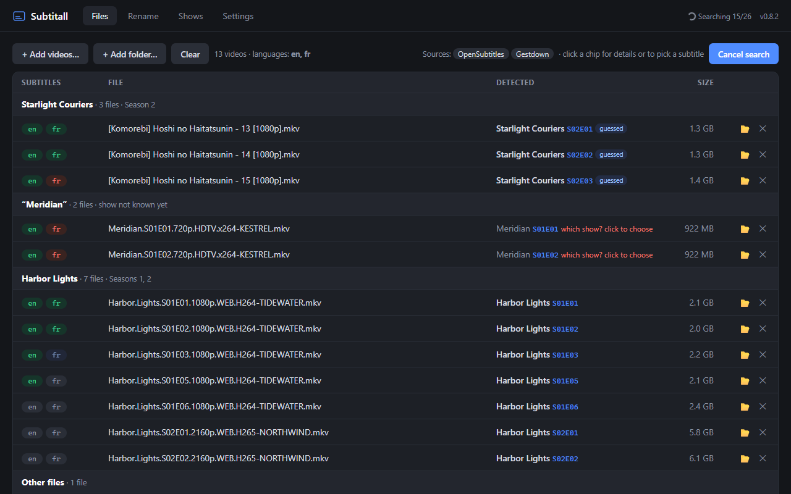
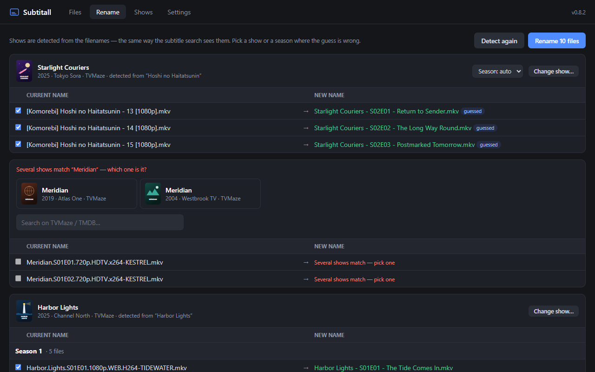
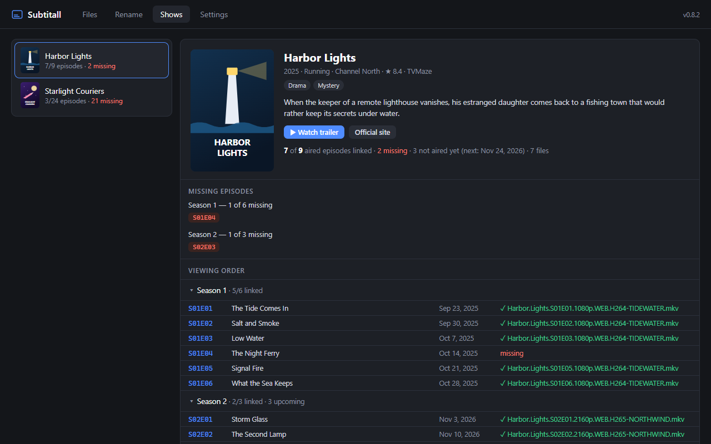
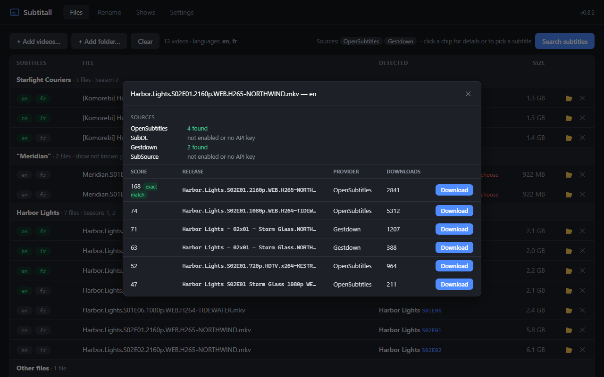
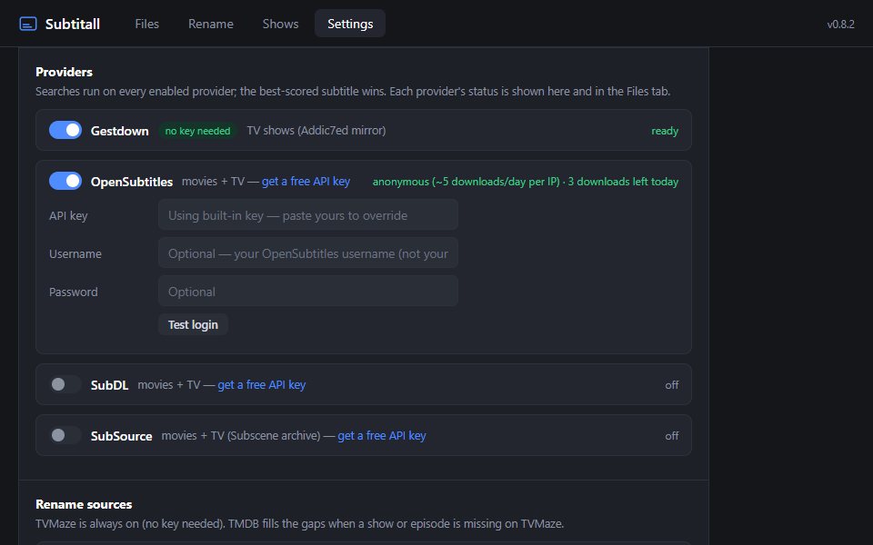

# Subtitall

[](https://github.com/Purgator/Subtitall/releases/latest)
[](LICENSE)

Find and download subtitles for your movies, TV shows and anime — a simple, lightweight desktop app with smart episode renaming.



Inspired by [Subber](https://github.com/noembryo/Subber).

## Features

| | |
|---|---|
|  |  |
| Rename episodes from the show's episode list. When a name is ambiguous, the app asks instead of guessing. | Read about each show and see which aired episodes you still have no file for. |
|  |  |
| Click a chip to see what every source answered and pick a subtitle yourself. | Turn sources on or off; each one says whether it is ready and how many downloads are left. |

- 🎬 **Link videos your way** — drag & drop files or folders anywhere in the window, or use the Add buttons. Folders are scanned recursively.
- 🧠 **Smart filename parsing** — show title, `S01E02` / `1x02` / `E02` / anime absolute numbering, year and release group are detected automatically, including season markers written into the title (`Show The Final Season - 15`, `Show Season 3 - 05`, `Show 2nd Season - 07`) and numbered specials (`Show OVA 2`, `Show - Special 3` → season 0).
- 🕵️ **Files with meaningless names** — when the filename says nothing, the app looks further: a Base64-encoded filename (some download bots do that) is decoded, then the title stored inside an MKV is tried, then the file's hash (size + checksum of its first and last 64 KiB) is looked up on OpenSubtitles. A small badge in the *Detected* column says where the name came from. Still nothing? Click the cell, type the show's name, pick it from the suggestions and choose the episode — that works for any file, including one the app got wrong.
- 🔮 **Season guessing** — files that carry only an episode number get their season worked out: from a season named in the title ("The Final Season" = the show's last one), from the other files of the same show in your list (`S04E29` next to `- 15` means S04E15), from the show's episode list (an episode 26 only fits the season that has 26 episodes), or by mapping absolute anime numbering onto seasons (`- 59` → S03E22). A guess is marked as such and explains itself; when it is only a plausible default you can set the season yourself, one batch of files at a time: a show's files are split by season (same folder, same name pattern), and each batch has its own season picker.
- 🗂️ **Grouped by show** — open several seasons, several shows and a few movies at once: the Files and Rename tabs show them as separate blocks, one per show (files using different names for the same show end up together) and one per movie series (*Harry Potter and the …* ×2 is one block); lone movies share a last block.
- 🌍 **Multiple languages** — pick any number of subtitle languages; each is saved as `video.<lang>.srt` next to the video so every media player picks it up.
- 🔎 **Four subtitle sources**
  - **Gestdown** (Addic7ed mirror) — TV shows, works out of the box, no account needed
  - **OpenSubtitles** — movies + TV, free API key
  - **SubDL** — movies + TV, free API key
  - **SubSource** (hosts the former Subscene archive) — movies + TV, free API key
- 🏆 **Best match wins** — results are ranked (exact file hash match, release-name similarity, popularity, hearing-impaired flag, provider reliability) and the best one downloads automatically. Prefer choosing yourself? Click a language chip to pick from the full list.
- 🛡️ **Built for reliability** — searches fan out to every enabled source in parallel; a source that keeps failing is put in a short cooldown instead of slowing everything down; every download is validated (an HTML error page never gets saved as `.srt`) and falls back to the next-best candidate across sources, never retrying the same source more than twice.
- 🔍 **No silent failures** — the Files tab says which sources a search uses, and every chip explains what each source did: found, nothing, can't search this kind of file, search error, download failed, cooling down, or *daily download quota used up* (with the reset time). A used-up quota is reported as such instead of looking like "nothing found", and the search keeps going on the other sources. OpenSubtitles account users see whether their login works and how many downloads are left today.
- 🎯 **One detection for everything** — each file's show is identified once, on [TVMaze](https://www.tvmaze.com) (always on, keyless) and optionally [TMDB](https://www.themoviedb.org) (free API key), and both the subtitle search and the rename feature use that same answer. When the name is ambiguous (two *Battlestar Galactica*s, a spin-off with the same name) the app asks you to pick from a short list instead of guessing; you can change the show or the season at any time by clicking a file's *Detected* cell, and set the show and episode of a single file by hand with *Identify*. Specials (OVAs…) are listed by title when a TMDB key is set — TVMaze does not number them.
- ✏️ **Episode renaming** — the Rename tab lists your files grouped by detected show, each group with its own *Change show…* button and a season picker per season of files, previews `Show - S01E02 - Title.mkv` names from the show's episode list, and renames the ones you confirm. Results from both metadata sources are merged; if one has no episode list, the other fills in. Subtitles sitting next to the videos are renamed too.
- 📺 **Shows tab** — every show your files were matched to, with its poster, summary, genres, status, network, rating, official site and trailer (trailers come from TMDB), the full episode list in viewing order with the file that covers each episode, and **what's missing**: aired episodes you have no file for, season by season (episodes that haven't aired yet are listed separately, with the next air date).
- 🇯🇵 **Anime-friendly** — alternate titles and acronyms are understood: files named `Shingeki no Kyojin` or `SnK` match *Attack on Titan* for both renaming and subtitle search, and absolute episode numbers (`- 59`) map onto the right season.
- 🔄 **Auto-update** — the app updates itself from GitHub Releases, showing the download in the top bar; *Settings → Updates* has a *Check for updates* button and a *Restart to update* button once the update is ready. Installing is silent: the app closes, updates in place without the setup wizard, and reopens by itself.

## Install (Windows)

1. Download `Subtitall-Setup-<version>.exe` from the [latest release](https://github.com/Purgator/Subtitall/releases/latest).
2. Run it. Windows SmartScreen may warn because the app is not code-signed — choose *More info* → *Run anyway*.
3. Launch **Subtitall** from the Start menu. Updates install automatically when you close the app.

## Quick start

1. **Add videos** — drop files or a folder into the window.
2. *(Optional)* Open **Settings** to pick your languages and add provider API keys — changes save themselves. *Test login* under OpenSubtitles checks your account.
   Official builds ship **built-in keys for OpenSubtitles and TMDB**, so those work out of the
   box; a key you enter yourself always takes precedence.
   - OpenSubtitles: create a free key under [API consumers](https://www.opensubtitles.com/en/consumers). Adding your username/password raises your daily download quota (the built-in key alone is capped at ~5 downloads/day per IP). Use your OpenSubtitles **username**, not your e-mail address — the API rejects e-mails.
   - SubDL: grab a free key from your [SubDL panel](https://subdl.com/panel/api).
   - SubSource: create a free key from your [SubSource profile](https://subsource.net/profile) (API tab).
   - TMDB (for renaming): create a free key in your [TMDB API settings](https://www.themoviedb.org/settings/api) — the v3 key and the v4 read-access token both work.
   - Gestdown and TVMaze need nothing; Gestdown is enabled by default (TV shows only).
   - SubDL and SubSource have no built-in key on purpose: their quotas are per key, so a
     shared key would be exhausted across all installs.
3. Hit **Search subtitles**. Green chips = subtitle saved next to the video; red chips = nothing saved — hover or click the chip to see what each source said.
4. **Rename episodes** (Rename tab): shows are detected for you — pick one where the app asks, fix a season if a guess is wrong (each show, and each season of its files, has its own picker), check the proposed names, click *Rename*.
5. **See what's missing** (Shows tab): pick a show to read about it, watch the trailer, and see which episodes you still need.

## Development

### Prerequisites

- [.NET SDK 10](https://dotnet.microsoft.com/download) (or newer)
- [Node.js 22+](https://nodejs.org) on your `PATH` (required by Electron.NET)

### Run

```bash
dotnet run --project src/Subtitall
```

This starts the ASP.NET Core backend and opens the Electron window ([ElectronNET.Core](https://github.com/ElectronNET/Electron.NET) launches Electron automatically).

### Test

```bash
dotnet test
```

### Screenshots

```bash
node tools/screenshots/capture.mjs
```

Regenerates the images of this README in `docs/`. The script serves the real UI
(`src/Subtitall/wwwroot`) with fictional demo data (`tools/screenshots/demo-data.mjs`) in place of
the backend and photographs each tab in headless Chrome or Edge (set `CHROME_PATH` if neither is
in a standard location). It needs no npm package, never reads your settings and contacts no
provider. Run it again after a visible UI change.

### Package a Windows installer

```bash
rm -rf src/Subtitall/bin/Release/net10.0/win-x64/publish
dotnet publish src/Subtitall -c Release -r win-x64 --self-contained true
```

The NSIS installer and its `.blockmap` land in `src/Subtitall/bin/Release/net10.0/win-x64/publish/`.
Delete that folder first: `dotnet publish` does not clean it, and stale files from a previous
publish would be packed into the installer. Without a `GH_TOKEN` environment variable the final
upload step fails — that's fine for a local build; the installer is already produced at that
point. Never set `GH_TOKEN` for a local package: release assets are built and uploaded by CI
only (see Releasing).

### Architecture

| Layer | Where | What |
|---|---|---|
| Core | `src/Subtitall/Core` | Filename parser, episode/season guesser, show detection, media library, subtitle providers, ranking, provider health tracking, TVMaze/TMDB clients, rename engine, settings |
| API | `src/Subtitall/Api` | Minimal-API REST endpoints + Server-Sent Events for live progress |
| UI | `src/Subtitall/wwwroot` | Simple tabbed interface — vanilla HTML/CSS/JS, zero frontend dependencies |
| Shell | `Program.cs` + ElectronNET.Core | Electron window, native dialogs, auto-update |
| Tests | `tests/Subtitall.Tests` | xUnit suite for the core logic |

Settings are stored in `%APPDATA%/Subtitall/settings.json`.

### Releasing

Releases are built by CI only — one release, one build. Never upload release assets from a
local machine: a second build on the same release can leave `latest.yml` describing a
different installer (sha512 mismatch), which breaks auto-update.

0. One-time setup: the repository secrets `OPENSUBTITLES_API_KEY` and `TMDB_API_KEY`
   (GitHub → Settings → Secrets and variables → Actions) become the build's built-in provider
   keys. They are injected at publish time as MSBuild properties and are never committed;
   dev builds have no built-in keys and fall back to user-entered ones.
1. Bump `<Version>` in `src/Subtitall/Subtitall.csproj` (semver), commit (`🔖 Release vX.Y.Z`) and push.
2. Tag that commit and push the tag:

   ```bash
   git tag vX.Y.Z && git push origin vX.Y.Z
   ```

   The tag triggers `.github/workflows/release.yml`, which runs the tests, builds the NSIS
   installer and uploads it (with `latest.yml` and the `.blockmap`) to a **draft** GitHub
   release for `vX.Y.Z`.
3. Review the draft on GitHub, add release notes, and **publish** it. Auto-update ignores
   drafts — installed apps only see the release once it is published. Publishing does not
   re-trigger CI (the tag already exists).

## License

[GNU General Public License v3.0 or later](LICENSE) (`GPL-3.0-or-later`)
